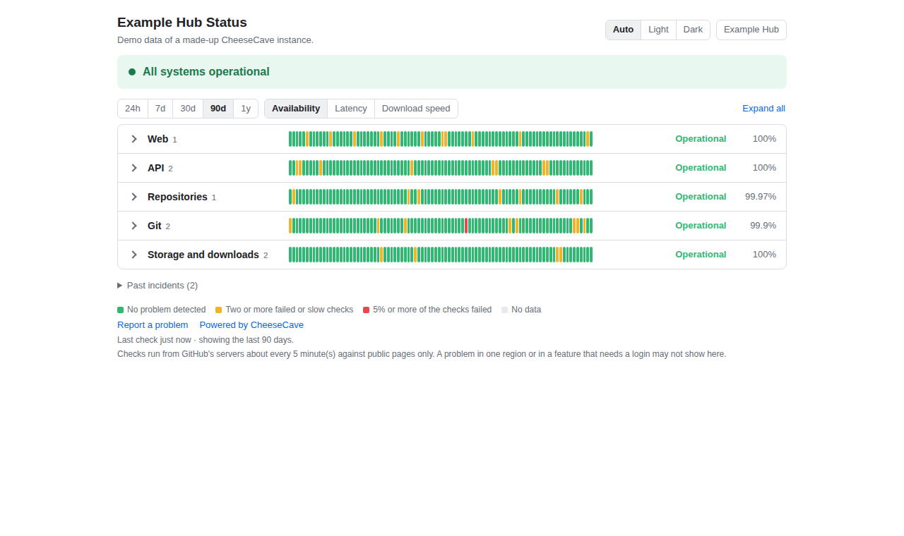
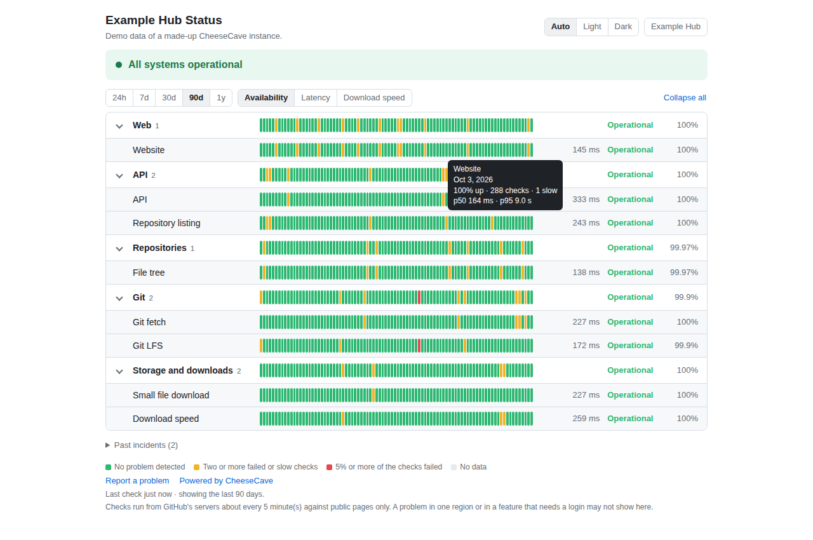
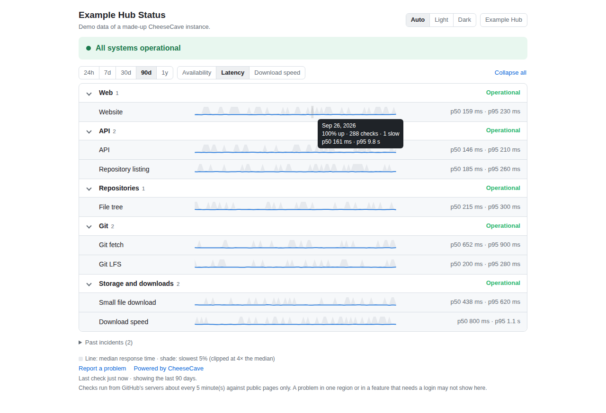
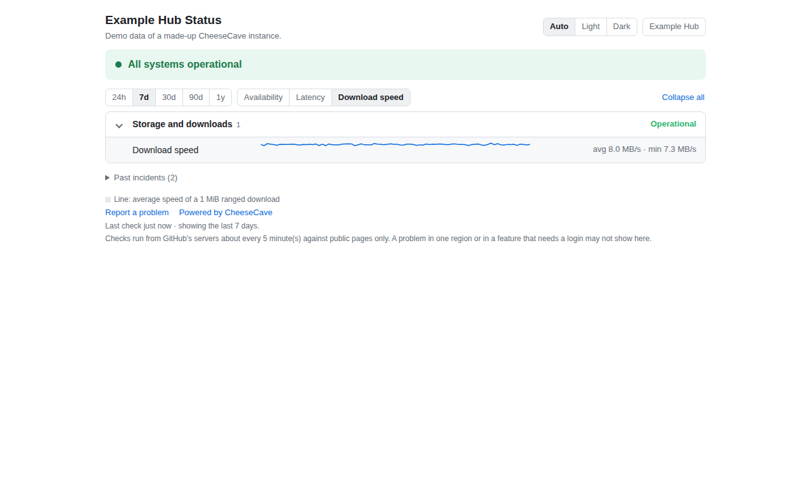
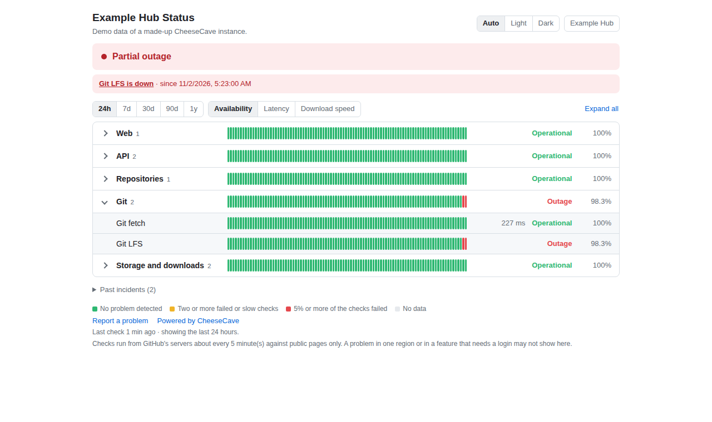
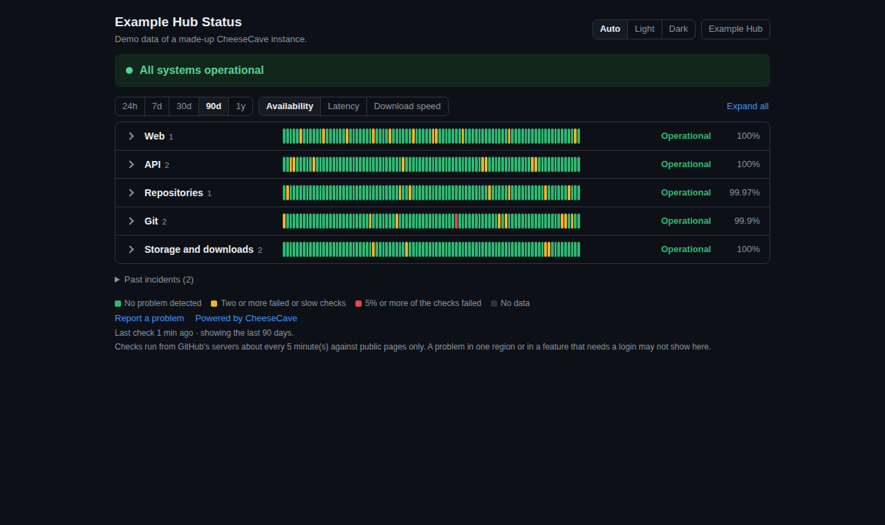
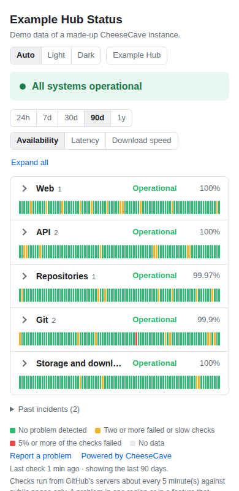

# CheeseCave status

A public status page for a [CheeseCave](https://github.com/cheesecave) instance, hosted on GitHub Pages and
run by GitHub Actions: the state of every service now, 24 hours to a year of history, latency and download
speed, and the incidents. Nothing in this repository names an instance: everything about one lives in its
own `status.config.json`, and an instance is a fork of this repository. [简体中文](README.zh-CN.md)

## What it looks like

*The pictures are the real page showing demo data of a made-up instance ("Example Hub"); regenerate them with
`docs/screenshots.py`.*

**Folded groups: every service on one screen, with 90 days of history.** Each bar is one day; hover for the numbers.



**Open a group for its services.** A group with a problem opens by itself.



**Latency**: the line is the median response time, the shade the slowest 5 %.



**Download speed** of a 1 MiB ranged download, here over the last 7 days.



**An outage**: the banner, the open incident (a GitHub issue that is opened and closed by itself), and the failed
checks of the last 24 hours.



**Dark theme** (or light, or follow the system) and **phones**:

 

## What you get

- **Time ranges**: 24 h, 7 d, 30 d, 90 d and 1 y, about 90 bars each (15 min, 2 h, 6 h, 1 day, 1 week per bar).
- **Three views**: availability (green, yellow, red bars), latency (median and slowest 5 %), download speed (a
  1 MiB ranged download, in MB/s).
- **Groups that fold**, like the big status pages: folded, a dozen services fit on one screen; a group with a
  problem opens by itself.
- Light, dark or automatic theme; refreshes itself every minute without a reload; works on a phone.
- **Outages open and close GitHub issues** (after two failed rounds in a row), and can post to a chat webhook.
- It says *"Status data is out of date"* when the last check is older than three intervals: a stopped monitor is
  never shown as green.

## How it works

```
Monitor (one long job)  --every 5 min-->  checks the instance  -->  `status` branch
                                                                      (checks/, hourly/, view/, status.json)
                                                                            ^
Pages (a static page, deployed rarely)  --the page reads the branch every minute--+
```

- **Monitor** (`scripts/monitor.py`, Python standard library only) probes every component of the config, appends
  the result to `checks/YYYY-MM-DD.jsonl` (kept 14 days), rolls every hour up into `hourly/YYYY-MM.json` (kept
  for good), rebuilds `view/*.json` and `status.json`, and force-pushes one fresh commit to the `status` branch.
  The files are the history, so the branch does not grow.
- **Pages** (`site/index.html`) is static. It reads `status.json` and the view of the selected range from the
  `status` branch, and falls back to the copy deployed with the page. A new check never needs a deployment.
- **Why one long job and not `schedule`**: GitHub's cron is best-effort; in the repository this was written for it
  fired about every 3 hours instead of every 5 minutes. A run of Monitor loops for about 5 h 35 min and starts the
  next copy of itself (`workflow_dispatch` is allowed with the default token); the hourly cron only restarts the
  chain if it ever broke.

## Set up an instance

1. **Fork this repository** into an account that the instance itself does not depend on (so that the page survives
   an outage of the instance), for example `<org>/<instance>-status`.
2. In the fork, add the instance's own files (the upstream has none of these, so syncing never conflicts):
   - `status.config.json`: copy [`status.config.example.json`](status.config.example.json) and edit it (below).
   - `.github/workflows/monitor.yml`, `pages.yml`, `sync-upstream.yml`: copy them from
     [`templates/instance/`](templates/instance). They are a few lines each and call the reusable workflows of this
     repository.
3. Settings: **Actions** enabled (forks start with workflows disabled); **Pages** source *GitHub Actions*;
   Actions, workflow permissions *read and write*.
4. Run **Monitor** once from the Actions tab (it keeps itself going), then **Pages**.

### `status.config.json`

| key | meaning |
|---|---|
| `name`, `base_url` | shown in the header; the address that `path` is relative to |
| `description` | one line under the title (optional) |
| `links.header`, `links.footer` | the buttons at the top right and the links under the page: lists of `{"label", "url"}` (http or https). Without `links` the header gets one button, "Go to *name*", that leads to `base_url`; with `links` only what you list is shown (an empty list shows none) |
| `components[].name` | shown on the page; unique |
| `components[].group` | the folding group (default `Services`) |
| `components[].path` or `.url` | exactly one of them |
| `components[].method`, `.body`, `.headers` | e.g. a `POST` to the LFS batch API, or a `Range` header |
| `components[].expect_status` | accepted status codes (default: any 2xx; redirects are followed) |
| `components[].expect_json` | keys the JSON body must have, e.g. `{"api": "cheesecave"}` (catches an error page served with `200`) |
| `components[].expect_text` | a text the start of the body must contain |
| `components[].max_bytes` | how much of the body to read (default 1 MB) |
| `components[].speed`, `.min_speed` | measure MB/s of the body; below `min_speed` the check is *degraded* |
| `components[].degraded_ms` | slower than this is *degraded* (default: the global value) |
| `interval_seconds`, `timeout_seconds`, `degraded_ms`, `raw_days`, `confirm_failures` | defaults 300, 20, 8000, 14, 2 |

Useful components for a CheeseCave instance (all work without logging in; replace `OWNER/REPO` with a small public
repository of yours that has a file of at least 1 MiB): the home page; `/api/version` (answers
`{"api": "cheesecave", …}`); `/api/models?limit=1` (the database); `/api/{type}s/OWNER/REPO/tree/main` (the version
store); `/{type}s/OWNER/REPO.git/info/refs?service=git-upload-pack` (git fetch); the LFS batch endpoint (`POST`);
a `Range` request for a small file (follows the redirect to the object storage); a 1 MiB `Range` request for the
download speed.

### Links (buttons)

Where the page leads to is yours to choose, in `status.config.json`:

```json
"links": {
  "header": [{ "label": "My Hub", "url": "https://hub.example.org" }],
  "footer": [
    { "label": "Report a problem", "url": "https://github.com/OWNER/REPO/issues" },
    { "label": "Powered by CheeseCave", "url": "https://github.com/cheesecave" }
  ]
}
```

`header` links are the buttons at the top right (next to the theme switch), `footer` links are listed under the
services. Good candidates: the instance itself, its documentation, a way to report a problem, the repository of this
page. Only `http` and `https` addresses are accepted (the config is checked when the monitor starts).

### Secrets and variables (all optional)

| name | for |
|---|---|
| secret `SYNC_TOKEN` | `sync-upstream.yml`: a fine-grained personal access token (or GitHub App token) with *Contents* and *Workflows* write access to the fork. GitHub refuses to merge upstream changes of workflow files with the default token. |
| secret `NOTIFY_WEBHOOK` | a chat webhook that gets "outage" and "recovered" messages |
| variable `NOTIFY_STYLE` | `slack` (default), `discord` or `lark`: the shape of the message |

The checks themselves need no secret.

## Stay up to date

`sync-upstream.yml` merges this repository into the fork every day and redeploys the page. Keep your own changes to
`status.config.json` and the three workflow files, and the merge has nothing to conflict on. If it fails (a conflict,
or workflow files without `SYNC_TOKEN`) it opens one issue that says why.

## Limits, said plainly

- The checks run from GitHub's servers, one region, against public pages only. A problem seen in one region, or in a
  feature that needs a login, may not show here.
- A bar is one bucket of checks: one failed or slow check is a blip (an outage needs two rounds in a row); two make
  the bar yellow; 5 % of the checks failing (at least two) make it red. The tooltip has the exact numbers. Bars of
  30 d and longer are made from hourly rows (the latency of a bucket is the median of the hourly medians and the
  largest hourly 95th percentile).
- A long-running job that is restarted all day is a heavier use of GitHub Actions than a short cron; check GitHub's
  terms for your account. An external scheduler (a cron service that calls `workflow_dispatch`) is the alternative.
- The DNS and the hosting of the page should not be the instance's: a page on the instance's own domain does not
  survive a DNS outage of that domain.

## Develop

```sh
python3 -I scripts/test_rollup.py
python3 -I scripts/test_statuslib.py
python3 -I scripts/test_e2e.py        # the whole chain against a local server and a local bare repository
python3 scripts/monitor.py --config status.config.json --minutes 1 --remote /path/to/a/bare/repo
python3 scripts/build_pages.py --out public --repo OWNER/REPO               # then serve `public/`
python3 scripts/demo_data.py --out demo --scenario outage                   # a demo site with made-up data (or `normal`)
python3 docs/screenshots.py            # the pictures of this README (needs Playwright; CHROMIUM=/path/to/browser if needed)
```

## License

AGPL-3.0, like the other CheeseCave repositories: see [LICENSE](LICENSE).
