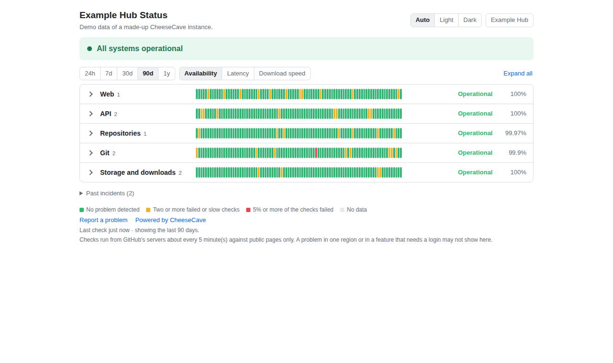
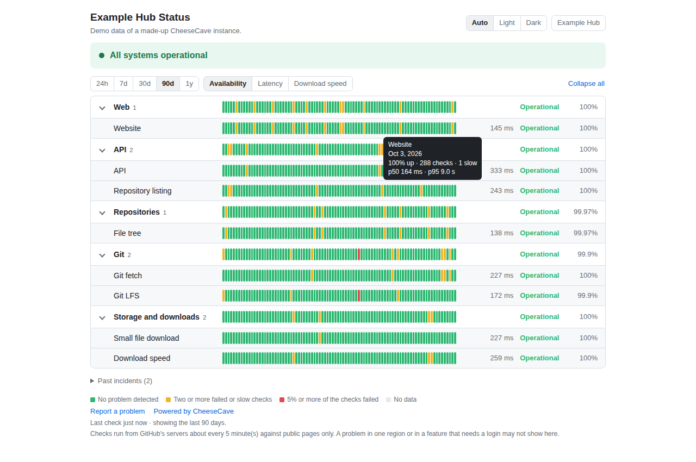
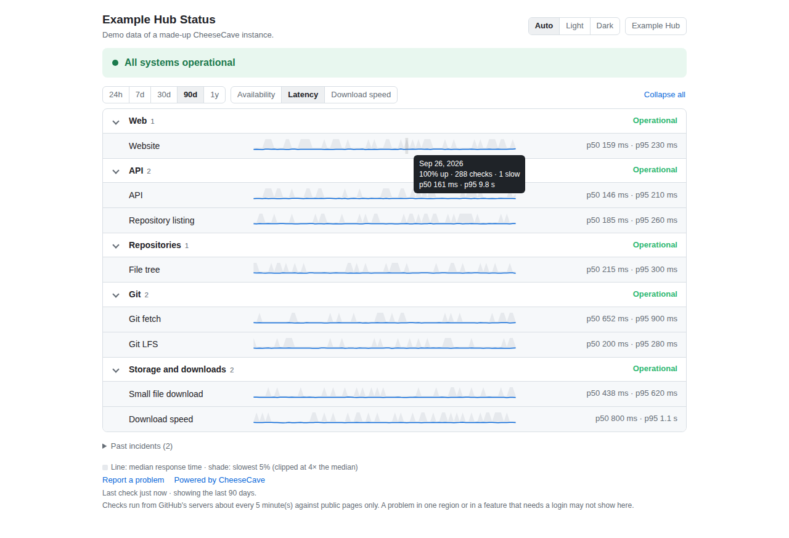
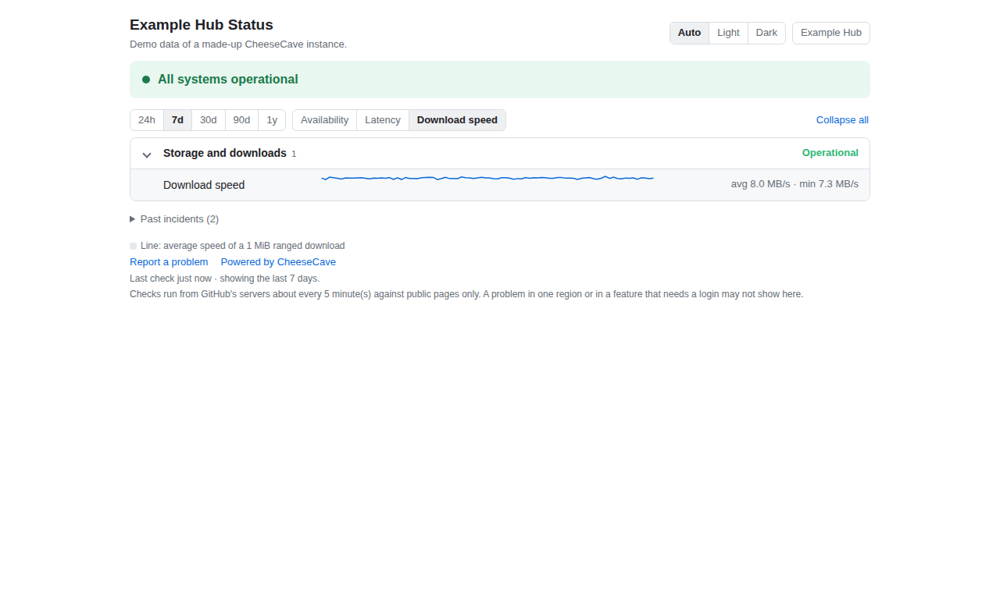
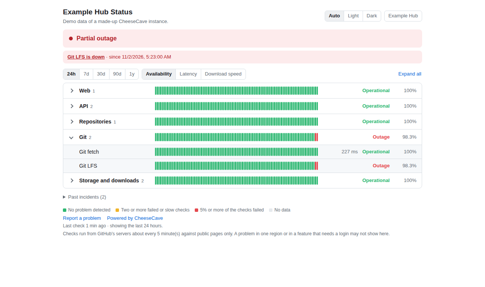
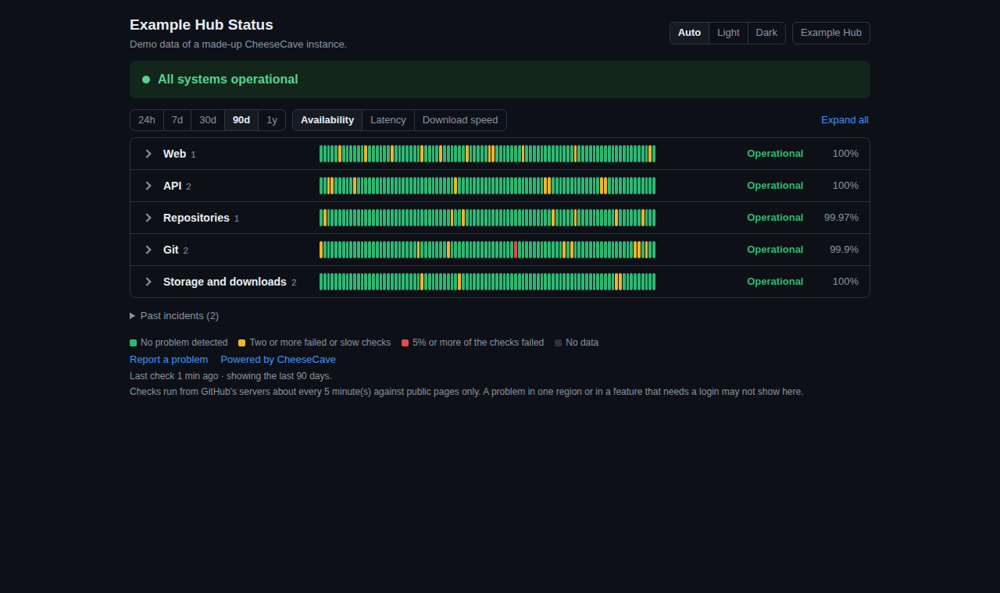
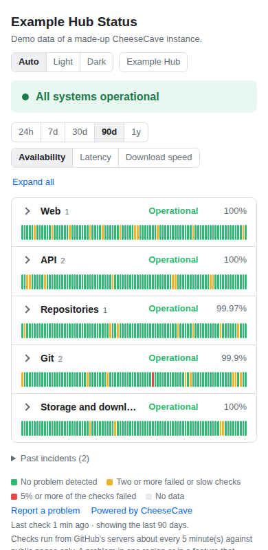

# CheeseCave 状态页

给 [CheeseCave](https://github.com/cheesecave) 实例用的公开状态页，托管在 GitHub Pages，由 GitHub Actions 运行：
显示各服务当前状态、24 小时到 1 年的历史、延迟与下载速度，以及故障事件。本仓库不绑定任何实例，一个实例的全部信息都在它自己的
`status.config.json` 里，实例仓库就是本仓库的 fork。[English](README.md)

## 长什么样

*下面的图是真实页面显示一个虚构实例（"Example Hub"）的演示数据；可以用 `docs/screenshots.py` 重新生成。*

**分组折叠：所有服务一屏看完，带 90 天历史。** 每格是一天，悬停可看具体数字。



**展开分组查看各个服务。** 有问题的分组会自动展开。



**延迟**：线是响应时间的中位数，阴影是最慢的 5%。



**下载速度**：1 MiB 范围下载的速度，这里是最近 7 天。



**故障时**：横幅、进行中的事件（会自动开关的 GitHub Issue），以及最近 24 小时里失败的检查。



**深色主题**（也可选亮色，或跟随系统）以及**手机**：

 

## 功能

- **时间范围**：24 小时、7 天、30 天、90 天、1 年，每个范围约 90 格（每格 15 分钟、2 小时、6 小时、1 天、1 周）。
- **三种视角**：可用率（红黄绿色块）、延迟（中位数与最慢 5%）、下载速度（1 MiB 范围下载，单位 MB/s）。
- **可折叠的分组**，参考大型状态页的做法：折叠后十几个服务一屏看完；有问题的分组会自动展开。
- 亮色、深色、自动三种主题；每分钟自动刷新，无需手动刷新页面；手机可用。
- **故障会自动开和关 GitHub Issue**（连续两轮失败才算），也可以推送到聊天机器人的 webhook。
- 最近一次检查超过三个检查间隔时，页面会显示"状态数据已过期"，监控停了不会被显示成绿色。

## 工作方式

```
Monitor（一个长任务）--每 5 分钟-->  检查实例  -->  `status` 分支
                                                  （checks/、hourly/、view/、status.json）
                                                                ^
Pages（静态页面，很少部署）--页面每分钟读取该分支--------------+
```

- **Monitor**（`scripts/monitor.py`，只用 Python 标准库）探测配置里的每个组件，结果追加到 `checks/YYYY-MM-DD.jsonl`（保留 14 天），
  每小时汇总成 `hourly/YYYY-MM.json`（永久保留），重建 `view/*.json` 和 `status.json`，并向 `status` 分支强制推送一个全新的提交。
  文件本身就是历史，所以分支不会越来越大。
- **Pages**（`site/index.html`）是静态页面，从 `status` 分支读取 `status.json` 和所选范围的数据，读不到时回退到随页面部署的副本。
  新的检查不需要重新部署。
- **为什么是一个长任务而不是 `schedule`**：GitHub 的定时触发是尽力而为，写这个仓库时它大约每 3 小时才触发一次而不是每 5 分钟。
  所以 Monitor 的一次运行会循环约 5 小时 35 分，结束时再启动下一个自己（默认令牌允许 `workflow_dispatch`）；每小时的定时触发只用来在链条断了时重新拉起。

## 搭建一个实例

1. **把本仓库 fork 到实例本身不依赖的账号下**（这样实例故障时状态页仍然可用），例如 `<组织>/<实例>-status`。
2. 在 fork 里加入实例自己的文件（上游没有这些文件，所以同步不会冲突）：
   - `status.config.json`：复制 [`status.config.example.json`](status.config.example.json) 后修改（见下）。
   - `.github/workflows/monitor.yml`、`pages.yml`、`sync-upstream.yml`：从 [`templates/instance/`](templates/instance) 复制，各只有几行，调用本仓库的可复用工作流。
3. 设置：启用 **Actions**（fork 默认禁用工作流）；**Pages** 来源选 *GitHub Actions*；Actions 的工作流权限选 *读写*。
4. 在 Actions 页手动运行一次 **Monitor**（之后它会自己续上），再运行 **Pages**。

### `status.config.json`

| 键 | 含义 |
|---|---|
| `name`、`base_url` | 页头显示的名称；`path` 相对的地址 |
| `description` | 标题下的一行说明（可选） |
| `links.header`、`links.footer` | 右上角的按钮和页面下方的链接，各是 `{"label", "url"}` 的列表（http 或 https）。不配置 `links` 时，页头有一个指向 `base_url` 的"Go to *名称*"按钮；配置了就只显示你列出的（空列表则一个都不显示） |
| `components[].name` | 页面上显示的名称，不能重复 |
| `components[].group` | 折叠分组（默认 `Services`） |
| `components[].path` 或 `.url` | 二选一，且只能有一个 |
| `components[].method`、`.body`、`.headers` | 例如向 LFS 批量接口发 `POST`，或带 `Range` 头 |
| `components[].expect_status` | 可接受的状态码（默认任意 2xx，会跟随跳转） |
| `components[].expect_json` | 返回的 JSON 必须包含的键值，如 `{"api": "cheesecave"}`（能发现"错误页却返回 200"） |
| `components[].expect_text` | 返回内容开头必须包含的文字 |
| `components[].max_bytes` | 最多读取多少响应内容（默认 1 MB） |
| `components[].speed`、`.min_speed` | 测量 MB/s；低于 `min_speed` 记为"性能下降" |
| `components[].degraded_ms` | 慢于此值记为"性能下降"（默认取全局值） |
| `interval_seconds`、`timeout_seconds`、`degraded_ms`、`raw_days`、`confirm_failures` | 默认 300、20、8000、14、2 |

CheeseCave 实例建议监控的项目（都无需登录；把 `OWNER/REPO` 换成你的一个公开小仓库，其中要有一个至少 1 MiB 的文件）：首页；`/api/version`
（返回 `{"api": "cheesecave", …}`）；`/api/models?limit=1`（数据库）；`/api/{type}s/OWNER/REPO/tree/main`（版本存储）；
`/{type}s/OWNER/REPO.git/info/refs?service=git-upload-pack`（git fetch）；LFS 批量接口（`POST`）；对小文件的 `Range` 请求（会跟随跳转到对象存储）；
对大文件 1 MiB 的 `Range` 请求（用于下载速度）。

### 链接（按钮）

页面跳转到哪里由你在 `status.config.json` 里决定：

```json
"links": {
  "header": [{ "label": "My Hub", "url": "https://hub.example.org" }],
  "footer": [
    { "label": "Report a problem", "url": "https://github.com/OWNER/REPO/issues" },
    { "label": "Powered by CheeseCave", "url": "https://github.com/cheesecave" }
  ]
}
```

`header` 里的链接显示为右上角的按钮（主题切换旁边），`footer` 里的链接列在服务列表下方。适合放：实例本身、文档、反馈问题的入口、状态页本身的仓库。
只接受 `http` 和 `https` 地址（监控启动时会检查配置）。

### Secret 与变量（都是可选的）

| 名称 | 用途 |
|---|---|
| secret `SYNC_TOKEN` | 给 `sync-upstream.yml`：对该 fork 有 *Contents* 和 *Workflows* 写权限的细粒度个人访问令牌（或 GitHub App 令牌）。上游改了工作流文件时，默认令牌无法合并。 |
| secret `NOTIFY_WEBHOOK` | 接收"故障"和"恢复"消息的聊天机器人 webhook |
| 变量 `NOTIFY_STYLE` | `slack`（默认）、`discord` 或 `lark`：消息的格式 |

检查本身不需要任何 secret。

## 保持更新

`sync-upstream.yml` 每天把本仓库合并进 fork 并重新部署页面。只要你自己的改动限于 `status.config.json` 和那三个工作流文件，合并就不会冲突。
合并失败（冲突，或缺少 `SYNC_TOKEN` 而上游改了工作流文件）时会开一个说明原因的 Issue。

## 局限，直说

- 检查从 GitHub 的服务器发起，只有一个地区，且只探测公开页面。某个地区的问题，或需要登录的功能出问题，这里可能看不出来。
- 一个色块是一组检查的汇总：一次失败或变慢是偶发（故障要连续两轮）；两次让色块变黄；5% 的检查失败（至少两次）变红，悬停提示里有精确数字。
  30 天及以上的色块由小时汇总得到（一个桶的延迟取各小时中位数的中位数、各小时 95 分位的最大值）。
- 一整天不断重启的长任务，比短的定时任务更重地使用 GitHub Actions，请查看 GitHub 对你账号的条款。替代方案是外部调度器（用定时服务调用 `workflow_dispatch`）。
- 页面的 DNS 和托管不应属于实例自己：放在实例自己域名下的页面，扛不住该域名的 DNS 故障。

## 开发

```sh
python3 -I scripts/test_rollup.py
python3 -I scripts/test_statuslib.py
python3 -I scripts/test_e2e.py        # 对本地服务器和本地裸仓库跑完整流程
python3 scripts/monitor.py --config status.config.json --minutes 1 --remote /path/to/a/bare/repo
python3 scripts/build_pages.py --out public --repo OWNER/REPO               # 然后用静态服务器打开 public/
python3 scripts/demo_data.py --out demo --scenario outage                   # 用虚构数据生成演示站（或 `normal`）
python3 docs/screenshots.py            # 重新生成本文的图片（需要 Playwright；必要时设 CHROMIUM=/浏览器路径）
```

## 许可证

AGPL-3.0，与 CheeseCave 的其他仓库一致，见 [LICENSE](LICENSE)。
